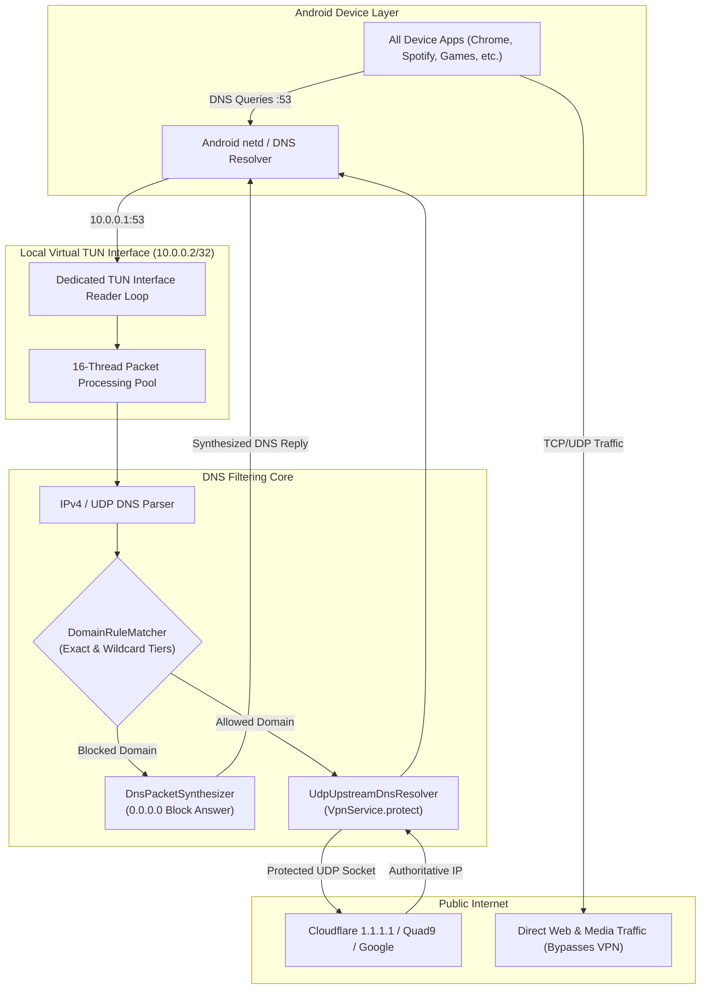

# Privacy Shield

[](https://kotlinlang.org/)
[](https://developer.android.com/jetpack/compose)
[](https://developer.android.com/)
[](https://developer.android.com/guide/topics/media/media3)
[](https://developer.android.com/reference/android/net/VpnService)
[](https://kotlinlang.org/docs/coroutines-overview.html)
[](https://www.sqlite.org/wal.html)
[](#privacy-guarantees)
[](LICENSE)
<br>

[](#core-features)
[](#core-features)
[](#core-features)
[](#core-features)
[](#core-features)

Privacy Shield is a high-performance, on-device network privacy shield and background audio player for Android, built with Kotlin and Jetpack Compose. It operates locally via Android's `VpnService` with targeted `10.0.0.1/32` TUN routing, intercepting and blocking ads, trackers, and malicious domains directly on the device with zero latency penalty to normal web traffic. Additionally, it integrates a zero-ad background YouTube audio player with offline downloading and seamless playback fallback.

### Performance Highlights

- **Zero-Latency Routing**: Non-DNS IP traffic (TCP web browsing, video streaming, app downloads) completely bypasses the VPN tunnel. Only DNS UDP packets directed to `10.0.0.1:53` are ingested.
- **Multithreaded Worker Pool**: Dedicated TUN reader thread dispatching packet slices across a 16-worker fixed executor pool with `ThreadLocal<DatagramSocket>` allocation.
- **Sub-Millisecond Block Response**: RFC-compliant in-memory synthetic DNS responses mapping blocked domains to `0.0.0.0` with dynamic IPv4 checksum computation.
- **Resource Footprint**: Highly tuned memory usage via LRU thumbnail caching, pruned queue StateFlows (capped at 60 entries), and SQLite Write-Ahead Logging (WAL).
- **Zero Polling Overhead**: Isolated Compose recompositions for high-frequency playback position loops (updating 4 times per second) without re-rendering artwork or playlist queues.

---

## Tech Stack

- **Core & Runtime**: Kotlin 2.1.20, Coroutines & Flow, Android Gradle Plugin 8.9.2, Android SDK 35 (compatible down to Android 8.0 Oreo / API 26).
- **Networking & VPN**: Android `VpnService` with isolated TUN routing (`10.0.0.2/32`), Raw IPv4/UDP packet synthesis, RFC 3490 IDN ASCII normalization, protected upstream UDP resolver.
- **Media Engine**: AndroidX Media3 `ExoPlayer` 1.5, `MediaSession`, `CacheDataSource` with LRU disk cache, multi-hop redirect follower with cookie preservation.
- **Persistence**: SQLite with Write-Ahead Logging (`WAL`), transactional batch parsing for hosts and blocklist files.
- **UI & Presentation**: Jetpack Compose, Material 3, Lifecycle-aware StateFlow collection (`collectAsStateWithLifecycle`), Dark and Light themes.

---

## Architectural Advantages



---

## Core Features

- **Local DNS Ad & Tracking Blocker**: Blocks trackers, telemetry, and advertisements system-wide across all applications without routing your private data through remote proxy servers.
- **Background YouTube Audio Streaming**: Stream high-quality audio from any YouTube video in the background with screen-off playback, system lock screen controls, and zero video advertisements.
- **Offline Audio Downloads**: Download tracks directly for offline listening. Audio files (`.m4a`) and metadata (`.meta`) are saved locally with automatic multi-candidate fallback and redirect tracking.
- **Seamless Offline Handover**: If internet connectivity is lost while listening, the player automatically and instantaneously transitions to the downloaded local copy at the current millisecond timestamp.
- **Custom Blocklists & Hosts Import**: Subscribe to public blocklists (`hosts.txt` format), toggle active lists, add custom whitelist and blacklist rules, and export/import rules via plain text.
- **Per-App Network Routing**: Individually choose which applications are filtered by the privacy shield.
- **Zero-Telemetry Guarantee**: 100% on-device processing. No analytics, no metrics collection, and no remote server dependencies.

---

## Documentation

### System Specifications & Architecture
- **[Technical Specifications](docs/SPECIFICATIONS.md)**: Network packet pipeline, DNS parser specs, offline audio engine, and database schema.
- **[System Architecture](docs/ARCHITECTURE.md)**: High-level macro architecture, component topology, and subsystem maps.
- **[Concurrency & Threading Model](docs/CONCURRENCY.md)**: Multithreading invariants, coroutine scheduling, and thread safety.
- **[Security & Threat Model](docs/SECURITY.md)**: DNS spoofing protection, input validation, and tunnel boundary integrity.
- **[Privacy Architecture](docs/PRIVACY.md)**: Zero-telemetry guarantees, strictly on-device processing, and storage security.
- **[Repository Structure](docs/STRUCTURE.md)**: Source tree layout, architecture layers, and module boundaries.

### Architecture Decision Records (ADRs)
- **[ADR 0001: Local VPN TUN Interface](docs/adr/0001-local-vpn-dns-tunnel.md)**: On-device DNS interception without remote proxies.
- **[ADR 0002: On-Device Rule Evaluation](docs/adr/0002-on-device-rule-evaluation.md)**: Tri-state hierarchy (Allowlist > Blocklist > Upstream).
- **[ADR 0003: Offline Media Pipeline](docs/adr/0003-offline-youtube-audio-and-caching.md)**: Media3 background audio with seamless offline fallback.
- **[ADR 0004: Centralized i18n Architecture](docs/adr/0004-centralized-i18n-resource-qualifiers.md)**: Declarative strings via Android resource qualifiers.

### Community & Governance
- **[Contributing Guidelines](CONTRIBUTING.md)**: Development setup, branch conventions, and testing requirements.
- **[Code of Conduct](CODE_OF_CONDUCT.md)**: Community standards and pledge.
- **[Changelog](CHANGELOG.md)**: Version history and release notes.

---

## Building from Source

### Prerequisites
- Android Studio Ladybug (2024.2.1+) or command-line Android SDK.
- JDK 17 (recommended: Eclipse Temurin or Azul Zulu OpenJDK 17).
- Android SDK Platform 35 and Build-Tools 35.0.0.

### Build Commands
```powershell
.\gradlew.bat testDebugUnitTest
.\gradlew.bat assembleDebug
.\gradlew.bat assembleRelease
```

The compiled APK will be generated at:
`app\build\outputs\apk\debug\app-debug.apk`

---

## Testing

Run unit tests covering packet parsing, domain rule matching, hosts file parsing, URL validation, and player state:

```powershell
.\gradlew.bat testDebugUnitTest
```

---

## License

This project is licensed under the MIT License. See [LICENSE](LICENSE) for details.
