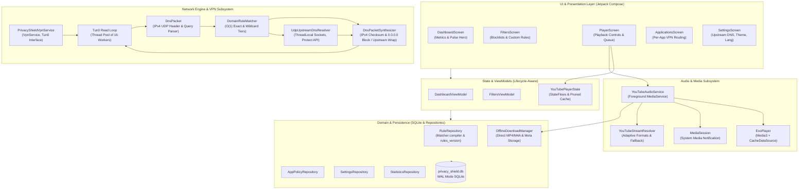

# Privacy Shield System Architecture

This document describes the high-level architecture, module topology, and data flow of Privacy Shield.

## Macro Topology

## Core Subsystems

### 1. High-Performance Local DNS VPN Engine
- **Address & Routing**: Privacy Shield configures a virtual TUN interface with a 32-bit subnet mask (`10.0.0.2/32`), setting the DNS server to `10.0.0.1` and routing strictly `10.0.0.1/32`.
- **Zero Traffic Overhead**: Non-DNS IP packets (TCP web browsing, video streaming, game traffic) are never diverted into the VPN tunnel. Only DNS UDP packets directed to `10.0.0.1:53` are ingested.
- **Worker Pipeline**: A dedicated reader thread continuously reads from the `ParcelFileDescriptor`. Packets are offloaded to an active 16-thread fixed executor pool.
- **Checksum & Validation**: Validates IPv4 headers and UDP lengths. The parser decodes DNS transaction IDs and query domain labels, normalizing them into ASCII IDN format.
- **Filter Evaluation**: The `DomainRuleMatcher` checks user allow rules, user block rules, and subscription lists in order of precedence using exact hash maps and recursive parent-domain lookups.
- **Blocked Queries**: Blocked queries receive a synthesized response mapping the domain to `0.0.0.0` with `ttl = 300` and an updated IPv4/UDP checksum.
- **Allowed Queries**: Allowed queries query upstream DNS (Cloudflare, Quad9, Google, or custom) using `UdpUpstreamDnsResolver` with `VpnService.protect(socket)` to prevent routing recursion.

### 2. Audio & Offline Download Engine
- **Background Playback**: Powered by AndroidX Media3 `ExoPlayer` wrapped in a foreground service (`YouTubeAudioService`) with interactive `MediaSession` controls.
- **Streaming & Resolution**: Resolves audio streams via `YouTubeStreamResolver` with fallback pipelines and prioritization of original and Ukrainian audio tracks.
- **Offline Storage**: `OfflineDownloadManager` fetches audio streams using HTTP redirect tracking with custom header and cookie preservation, saving direct `.m4a` files alongside persistent `.meta` metadata files.
- **Seamless Offline Fallback**: If network connectivity drops or the user initiates playback while offline, `YouTubeAudioService` instantly switches to the local audio file at the current millisecond timestamp without interrupting or throwing connection errors.

### 3. Reactive UI & State Management
- Built entirely on Jetpack Compose and Material 3 design tokens.
- Lifecycles are isolated using `collectAsStateWithLifecycle()` to prevent background battery drain.
- High-frequency UI events (playback progress sliders updating 4 times per second) are isolated in sub-composables to avoid whole-screen recompositions.
