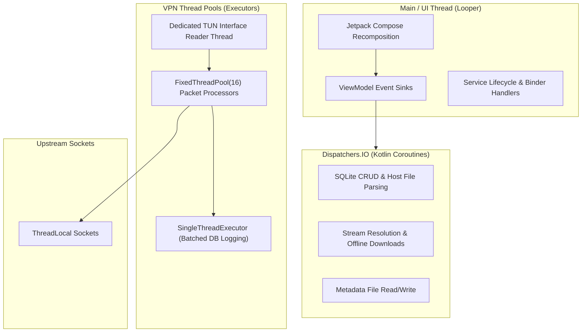

# Privacy Shield Concurrency & Threading Model

This document outlines the multithreading, coroutine scheduling, and thread-safety invariants utilized across Privacy Shield.

## Threading Topology

## Concurrency Invariants

### 1. TUN Packet Processing (16-Worker Pool)
- **Dedicated Read Loop**: A single low-priority thread runs a blocking loop on `FileInputStream(tunnelInterface.fileDescriptor).read(packetBuffer)`.
- **Parallel Dispatch**: Every packet slice is submitted to a 16-worker pool (`workerThreadPool = Executors.newFixedThreadPool(16)`).
- **Socket Isolation**: Each worker thread maintains a `ThreadLocal<DatagramSocket>`. Reusing thread-local sockets eliminates socket allocation churn and file-descriptor exhaustion while preventing inter-thread socket contention.
- **Socket Protection**: All sockets invoke `VpnService.protect(socket)` prior to any network I/O, guaranteeing that upstream DNS queries exit through the physical interface.

### 2. SQLite Database & Repositories
- **WAL Mode**: `DatabaseHelper` enables Write-Ahead Logging (`enableWriteAheadLogging()`), supporting concurrent readers alongside single writers.
- **Dispatchers.IO Isolation**: All repository reads and mutations are dispatched through `withContext(Dispatchers.IO)` or `viewModelScope.launch(Dispatchers.IO)` to protect the 60/120 FPS Compose main thread.
- **Transactional Consistency**: Multi-row operations, such as blocklist parsing and rule updates, run inside explicit SQLite transactions (`beginTransaction()`, `setTransactionSuccessful()`, `endTransaction()`).

### 3. State Management & Lifecycle Safety
- **StateFlow Pruning**: `YouTubePlayerState` limits thumbnail and cache flows to a maximum of 60 entries. When the threshold is reached, the oldest 20 entries are pruned.
- **Compose Lifecycle Observation**: Screens use `collectAsStateWithLifecycle()` rather than `collectAsState()`, stopping active collection and background loops when screens leave the `STARTED` lifecycle state.
- **Isolated Progress Loops**: Player progress tracking loops update `YouTubePlayerState.currentPositionMs` at 250ms intervals. This StateFlow is observed solely within isolated leaf composables (`PlaybackSlider`), preventing screen-wide recompositions.
